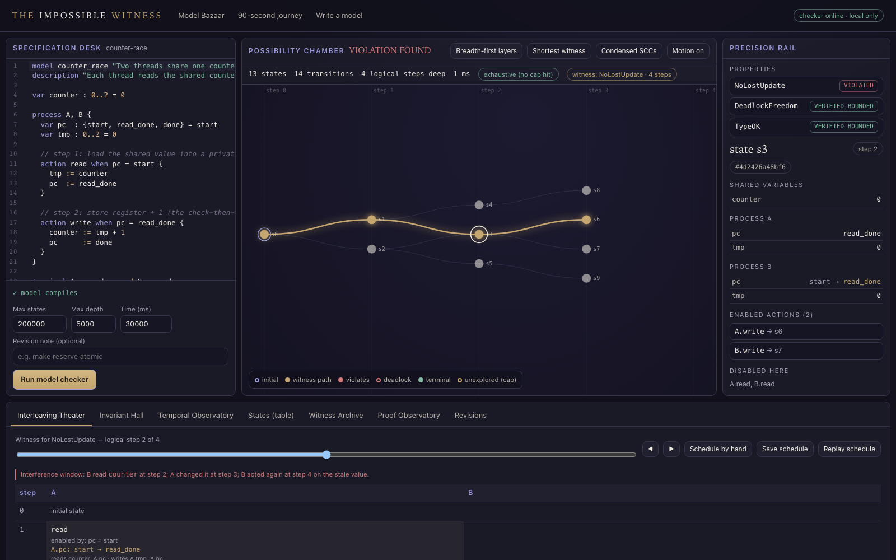

# THE IMPOSSIBLE WITNESS

**Can this system ever reach a state that should be impossible?**

A visual formal-methods laboratory for small concurrent systems. Write a finite model; a real
explicit-state model checker explores every reachable state and returns the **shortest
schedule** to a bad state — a witness you can step through, replay with an independent
evaluator, cross-check with **TLC**, and seal in a tamper-evident receipt — or reports that no
violation exists *in that bounded model*, or honestly says `INCOMPLETE`.



> Evidence covers only the finite model and its stated assumptions. It is never a proof about
> production software. See [docs/LIMITATIONS.md](docs/LIMITATIONS.md).

## Quick start

```bash
scripts/setup      # npm ci + pinned TLC v1.7.4 (checksum-verified)
scripts/doctor     # what this machine can do (TLC via Docker or Java?)
scripts/dev        # API 127.0.0.1:5721 + UI http://127.0.0.1:5720
```

Then click **Start the 90-second journey**. No cloud services or API keys are used. Without
Java/Docker everything works except TLC, which is labelled `INTERNAL_ONLY`.

Command line:

```bash
node src/cli/witness.ts check examples/counter-race.witness --receipt out/r.json
node src/cli/witness.ts verify out/r.json
node src/cli/witness.ts tlc examples/starvation-weak.witness
scripts/demo        # the whole vertical slice in a terminal
```

## What's inside

- **WML**, a typed modelling language with no way to run code ([docs/MODEL_LANGUAGE.md](docs/MODEL_LANGUAGE.md))
- **BFS explorer** with exact canonical states, shortest witnesses, deadlock vs intended
  termination, domain checks and hard resource caps ([docs/SEARCH_ALGORITHMS.md](docs/SEARCH_ALGORITHMS.md))
- **Liveness** (`eventually`, `leadsto`) under explicit weak/strong fairness with TLA+
  semantics ([docs/LIVENESS_AND_FAIRNESS.md](docs/LIVENESS_AND_FAIRNESS.md))
- **Independent replay** of every witness, **mutation testing** of models
- **TLC cross-check**: 150/150 comparisons agree across 34 models ([evidence/tlc-crosscheck.md](evidence/tlc-crosscheck.md))
- **Receipts** verified by digest, replay and full re-run ([docs/REPRODUCIBILITY.md](docs/REPRODUCIBILITY.md))
- **Eight rooms** in the UI: Possibility Chamber, Specification Desk, Interleaving Theater,
  Invariant Hall, Temporal Observatory, Witness Archive, Model Bazaar, Proof Observatory
  ([docs/PRODUCT.md](docs/PRODUCT.md))
- 17 scenarios / 35 executable models in [examples/](examples/)

## Tests

```bash
scripts/test           # typecheck + 110 unit/integration tests
scripts/test --e2e     # + 15 Playwright browser tests (6 acceptance journeys, a11y, mobile, XSS)
scripts/test --tlc     # + the live TLC corpus
scripts/reproduce      # re-verify every receipt in evidence/
```

Status of every feature: [docs/BUILD_LEDGER.md](docs/BUILD_LEDGER.md).
More: [ARCHITECTURE](docs/ARCHITECTURE.md) · [SECURITY](docs/SECURITY.md) ·
[TLC_COMPATIBILITY](docs/TLC_COMPATIBILITY.md) · [DESIGN_SYSTEM](docs/DESIGN_SYSTEM.md) ·
[RECRUITER_DEMO](docs/RECRUITER_DEMO.md) · [CONSTELLATION_INTEGRATION](docs/CONSTELLATION_INTEGRATION.md).

Private repository. Built with Node 24, TypeScript, React, Vite, CodeMirror 6 and TLC (MIT).
