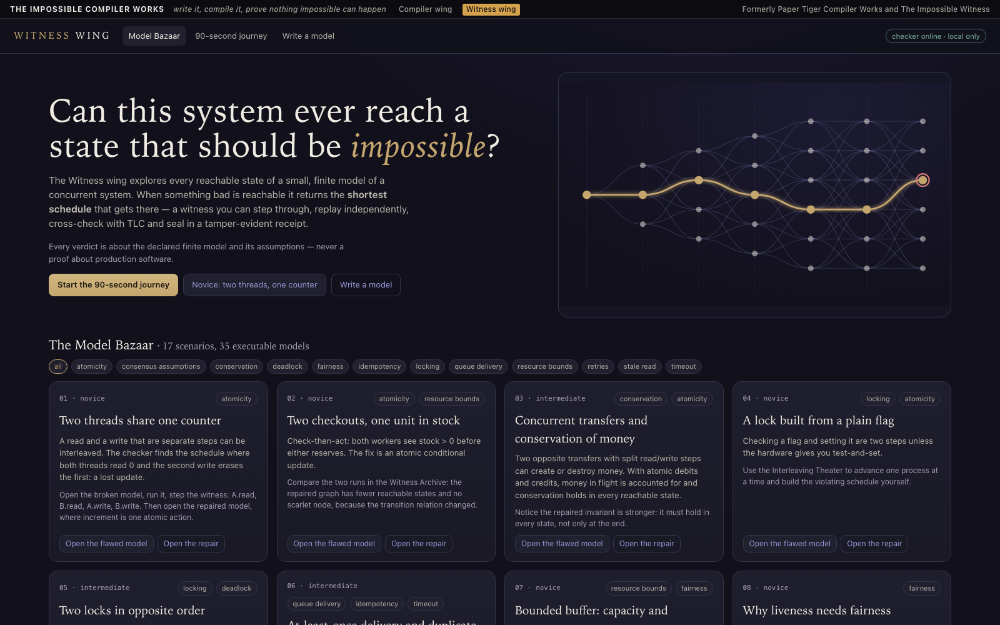

# THE IMPOSSIBLE COMPILER WORKS

**Write it, compile it, prove nothing impossible can happen.**

*Formerly Paper Tiger Compiler Works and The Impossible Witness.*

A laboratory with two wings that check each other:

- **Compiler wing.** FOLIO, a small typed diagram language, with a real compiler (lexer → parser → type checker →
  SSA-style IR → optimizer → bytecode), a bytecode VM, an independent reference interpreter used as an oracle, a
  differential fuzzer and fault lab, and an eight-mode browser IDE.
- **Witness wing.** An explicit-state model checker for finite concurrent models: breadth-first search with
  shortest counterexamples, deadlock detection, fairness-aware liveness, independent trace replay, TLC cross-checks
  and tamper-evident receipts.
- **Between them.** The Witness wing model-checks the Compiler wing's optimizer: every order and repetition of the
  optimization passes, checked against the reference interpreter
  ([docs/CROSS_FEATURE_PASS_ORDERS.md](docs/CROSS_FEATURE_PASS_ORDERS.md)).



> **Honest scope.** Verdicts cover a finite model, or one program with its fixtures and limits. They are never a
> proof about production software. See [docs/LIMITATIONS.md](docs/LIMITATIONS.md) and
> [wings/compiler/docs/LIMITATIONS.md](wings/compiler/docs/LIMITATIONS.md).

## Quick start (about 60 seconds)

You need Node 24 or newer. Docker or Java is optional (only for the TLC cross-check).

```bash
git clone <this repository> && cd impossible-witness
scripts/setup      # npm ci, plus the pinned TLC v1.7.4 jar (HTTPS, SHA-256 checked; skip with WITNESS_SKIP_TLC=1)
scripts/dev        # API on 127.0.0.1:5721, UI on http://127.0.0.1:5720
```

Open <http://127.0.0.1:5720/> for the Witness wing (click **Start the 90-second journey**) and
<http://127.0.0.1:5720/compiler/> for the Compiler wing. Everything runs on your machine, bound to `127.0.0.1`.
There are no accounts, no cloud services and no API keys. Without Java or Docker, everything works except TLC,
which is then labelled `INTERNAL_ONLY`.

From a terminal:

```bash
node src/cli/witness.ts check examples/counter-race.witness --receipt out/r.json   # find the lost update
node src/cli/witness.ts verify out/r.json                                          # re-check the receipt
npm run folio -- wings/compiler/examples/03-orrery.folio                           # compile and run FOLIO
npm run pass-check -- fault-lab-commute --mutant                                   # the cross-feature
```

## What is verified, and how

| Claim | How it is checked | Where |
|---|---|---|
| The optimized program draws exactly what the unoptimized one does | every run compares the VM's scene hash with the independent reference interpreter's; a differential fuzzer ran 4,000 programs with 0 divergences | [wings/compiler/evidence/fuzz-summary.json](wings/compiler/evidence/fuzz-summary.json) |
| No order or repetition of the safe passes changes a shipped program's output | the Witness wing searches the pass-order graph of all 14 shipped seeds; the deliberately wrong pass is caught with a 1-step counterexample | [evidence/bridge/](evidence/bridge/) |
| The model checker agrees with TLC | 150/150 comparisons agree across 34 models (verdicts, state counts, lassos re-derived by the independent replay evaluator) | [evidence/tlc-crosscheck.md](evidence/tlc-crosscheck.md) |
| Every counterexample is real | each trace is replayed by a separate evaluator before it is shown | [docs/REPRODUCIBILITY.md](docs/REPRODUCIBILITY.md) |
| Results are reproducible | receipts pin source, versions and hashes; `scripts/reproduce` re-runs every shipped receipt of both wings | [evidence/](evidence/), [wings/compiler/evidence/receipts/](wings/compiler/evidence/receipts/) |

## Tests

```bash
scripts/test           # typecheck, lint, Witness (112), Compiler (126) and bridge (11) tests, all receipts
scripts/test --e2e     # + Playwright journeys for both wings (27), on 127.0.0.1:5726/5727
scripts/test --tlc     # + the live TLC corpus (Docker or Java)
scripts/test --fuzz    # + 2,000 differential fuzz programs
```

## Layout

```
src/, web/, examples/, e2e/   Witness wing (model checker, API server, the shared Vite app and shell)
wings/compiler/              Compiler wing (FOLIO language, compiler, VM, oracle, fuzzer, IDE, its docs)
bridge/                      the cross-feature: optimizer pass orders checked by the Witness engine
evidence/                    receipts, TLC corpus, screenshots, benchmarks
```

One API process serves both wings (the Compiler wing's API is mounted at `/engine/compiler`), and one Vite app
serves both UIs. Architecture: [docs/ARCHITECTURE.md](docs/ARCHITECTURE.md) and
[wings/compiler/docs/ARCHITECTURE.md](wings/compiler/docs/ARCHITECTURE.md).

## Limits

- Models must be finite and small. Search stops at explicit caps and says `INCOMPLETE`, never "safe".
- FOLIO is a teaching-size language. The VM is sandboxed by construction (no I/O, fuel limits), not by an OS
  sandbox.
- The pass-order check covers the shipped seeds, with their fixtures and default limits, and the three
  optimization passes that exist. It is not a proof that the optimizer is correct for all programs.
- The server has no authentication. It is meant for one person on their own machine, bound to loopback.

## Security

See [SECURITY.md](SECURITY.md) for how to report a problem, and [docs/SECURITY.md](docs/SECURITY.md) for the
threat model, the public-release red-team findings and their fixes.

## How this was built

AI coding agents wrote most of the code under my direction and review. Every claim above links to the evidence
or test that backs it.

## License

MIT, see [LICENSE](LICENSE). Third-party components and their licences: [THIRD_PARTY_NOTICES.md](THIRD_PARTY_NOTICES.md).
